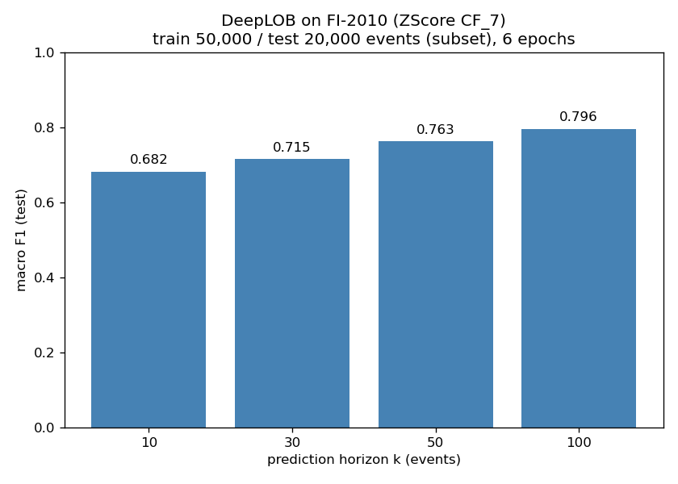
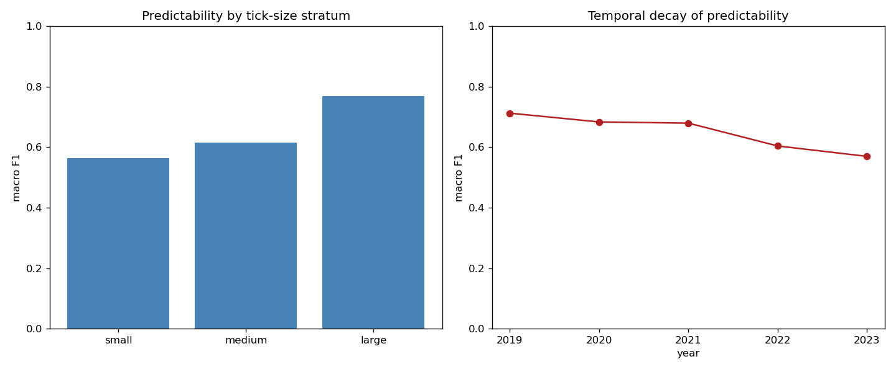
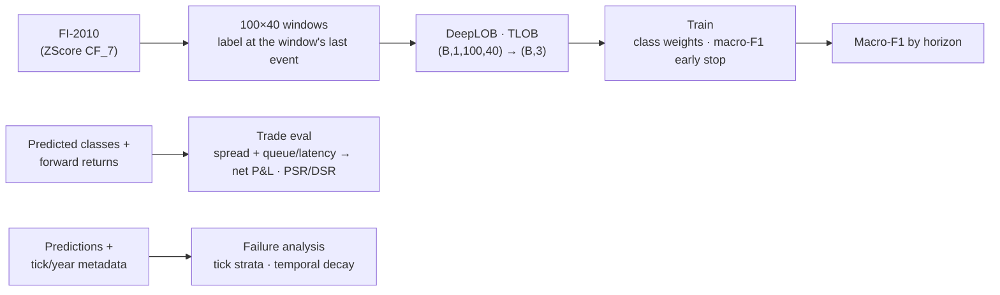

# Deep LOB Forecasting + Cost-Aware Trading Evaluation

[](https://github.com/kbd0011/deep-lob-forecasting/actions/workflows/ci.yml)
[](LICENSE)
[](https://www.python.org/)

PyTorch implementations of DeepLOB (Zhang, Zohren & Roberts, 2019) and the TLOB dual-attention transformer
(Berti & Kasneci, 2025) for short-horizon mid-price direction on limit-order-book data, a DeepLOB run on the
public FI-2010 benchmark, and a transaction-cost-aware trading evaluation that asks the question a macro-F1
score cannot answer: does the directional edge survive spread and queue/latency costs?

## Result: DeepLOB on FI-2010

DeepLOB trained on FI-2010 (ZScore normalization, CF_7 files) scores **macro-F1 0.682 at a 10-event horizon,
rising to 0.796 at 100 events** (0.715 at k=30, 0.763 at k=50). Longer horizons are easier to call in this run.



How the run is set up ([`scripts/run_fi2010.py`](scripts/run_fi2010.py)):
- **Data:** the first 50,000 events of the FI-2010 training file and the first 20,000 events of the test file
  (of 254,750 and 55,478), a subset sized for a CPU/Apple-MPS run.
- **Training:** one DeepLOB model per horizon, class-weighted cross-entropy, Adam, up to 6 epochs, fixed seed.
- **Model selection:** there is no separate validation split. After each epoch the trainer scores macro-F1 on
  the same 20,000-event test subset, keeps the best epoch, and stops after 3 epochs without improvement. The
  figures above are those best-epoch scores, so they are benchmark scores with epoch selection on the
  evaluation subset rather than an untouched hold-out estimate.

Reproduce with `make fi2010` (downloads FI-2010 from Kaggle; needs a Kaggle API token in `~/.kaggle/`).

## Cost-aware trading evaluation

[`src/backtest/trade_eval.py`](src/backtest/trade_eval.py) turns predicted classes into positions (up → long,
stationary → flat, down → short), charges half the quoted spread plus a queue/latency penalty on every unit of
turnover (defaults: 1.0 bps spread, 0.5 bps latency), and reports gross and net P&L, turnover, trade count,
hit rate, the Probabilistic Sharpe Ratio, and the Deflated Sharpe Ratio when the number of configurations
tried and their Sharpe variance are supplied.

The unit tests run it on synthetic predictions and returns, and one of them makes the project's thesis
concrete: a predictor that calls every direction correctly still nets zero or less when each unit of turnover
costs 10 bps against per-period moves with a standard deviation of about 2 bps. Accuracy and P&L are reported
side by side because they diverge once costs and turnover bite.

## Failure-analysis tooling (synthetic demo)

[`src/eval/strata.py`](src/eval/strata.py) computes macro-F1 by tick-size stratum and by year and plots both.
FI-2010's normalized arrays carry no per-instrument tick-size or date metadata, so the figure below runs the
tooling on synthetic predictions generated with a tick-size effect and a year-over-year decline built in. It
shows what the diagnostic produces; it is not a market finding.



## Pipeline


## Layout
```
deep-lob-forecasting/
├── src/models/deeplob.py       # DeepLOB: conv blocks, Inception module, LSTM
├── src/models/tlob.py          # TLOB: temporal + feature self-attention (einops)
├── src/data/fi2010.py          # FI-2010 loader, horizon labels, 100-event windows
├── src/train.py                # trainer: class weights, macro-F1 early stopping, Hydra entrypoint, optional wandb
├── src/backtest/trade_eval.py  # cost-aware net P&L, turnover, hit rate, PSR / Deflated Sharpe
├── src/eval/strata.py          # macro-F1 by tick stratum and by year, plots
├── shared/validation.py        # Sharpe statistics (PSR, DSR), purged K-fold, PBO
├── scripts/run_fi2010.py       # the FI-2010 run behind the figure above
├── configs/train.yaml          # Hydra config for `make train`
├── tests/                      # CPU-only unit tests on tiny tensors and synthetic arrays
├── IMPLEMENTATION_LOGIC.md
├── DATA.md
└── LLM_PROMPTS.md
```

Every module under `src/` has unit tests that run on CPU with no network, GPU or dataset download; the FI-2010 windowing
and label alignment are tested on a small synthetic array. DeepLOB and TLOB share the `(B,1,100,40) -> (B,3)`
contract, so either model runs through the same trainer and evaluation code.

## Reproduce
```bash
make setup && make check   # install, then lint + typecheck + tests (the same steps the CI workflow runs)
make fi2010                # download FI-2010 from Kaggle and rebuild the macro-F1-by-horizon figure
make train                 # Hydra run from configs/train.yaml (expects FI-2010 DecPre CF_7 files in data/)
```

## Design decisions
- **Accuracy is not P&L.** The trading evaluation charges half-spread plus a queue/latency penalty on turnover,
  so a high-macro-F1 model can still lose money; net and gross are always reported together.
- **Macro-F1 with inverse-frequency class weights**, so the score is not carried by the majority class.
- **One input/output contract for both models**, so DeepLOB and TLOB can be compared under identical training
  and evaluation.

## Scope and limitations
- The FI-2010 result uses a 50,000 / 20,000-event subset and up to 6 epochs, and the best epoch is chosen on
  the same test subset that is reported. A full-data run with a validation split carved from the training days
  is the next step before comparing against published figures.
- TLOB is implemented and unit-tested but not yet trained on FI-2010; the result above is DeepLOB only.
- The trading evaluation has been exercised on synthetic predictions and returns, not on model predictions
  over real order-book data.
- FI-2010 is a 2010 dataset of a few Nordic stocks. The tick-strata and temporal-decay diagnostics need data
  with instrument and date metadata (for example LOBSTER sample days), so here they are shown on synthetic
  predictions only.
- Next: DeepLOB vs TLOB per horizon on the full data, the trading evaluation on model predictions with aligned
  forward returns, LOBSTER samples for the strata and decay analysis, and a cost model calibrated to a venue.

## References
- Zhang, Z., Zohren, S. & Roberts, S. (2019). *DeepLOB: Deep Convolutional Neural Networks for Limit Order Books.* IEEE Trans. Signal Processing.
- Berti, L. & Kasneci, G. (2025). *TLOB: A Dual-Attention Transformer for Limit Order Book forecasting.* (implemented here)
- Ntakaris, A. et al. (2018). *Benchmark dataset for mid-price forecasting of limit order book data (FI-2010).* J. Forecasting.
- López de Prado, M. (2018). *Advances in Financial Machine Learning* (Deflated Sharpe, honest backtesting). Wiley.
